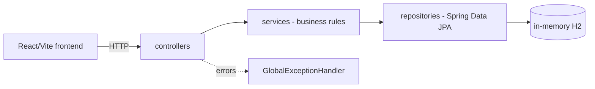

# app-bancario-digital

**English** · [Português (Brasil)](README.md)

[](#) [](#) [](#) [](#) [](#) [](#) [](LICENSE)

## What it is

A full-stack digital account: a **REST API in Java 21 + Spring Boot 3** for accounts, deposits, withdrawals, transfers and statements, plus a **React 18 + TypeScript frontend** (Vite + Tailwind) that consumes the endpoints. MVP scope: accounts, transfers with balance validation, statement.

## Status

Working and tested: **40 JUnit tests** passing (`mvn test`), BUILD SUCCESS. Academic/portfolio project.

## Features

- **Accounts** (`ContaController`): create (`POST /contas`), fetch by id (`GET /contas/{id}`), list (`GET /contas`), deposit (`POST /contas/{id}/depositar`) and withdraw (`POST /contas/{id}/sacar`).
- **Transfers** (`TransferenciaController`): `POST /transferencias` validates balance and source/target accounts; fails with `SaldoInsuficienteException`.
- **Statement** (`ExtratoController`): `GET /extrato/{contaId}` returns the account entries.
- **Global error handling** (`GlobalExceptionHandler`): maps missing account, invalid operation and insufficient balance to error responses with `ErrorResponse`.
- **Frontend**: three screens (accounts, transfers, statement by account) in React Router.

## Architecture

Layered controller → service → repository (Spring Data JPA) over in-memory H2; the frontend talks to the API over HTTP.



## Stack

- Java 21, Spring Boot 3.4.4 (`starter-web`, `starter-validation`, `starter-data-jpa`)
- In-memory H2 (`jdbc:h2:mem:bancodigital`, `ddl-auto=create-drop`)
- Lombok
- Frontend: React 18, TypeScript 5.6, Vite 5, Tailwind 3, react-router-dom 6
- Tests: JUnit 5 + Spring Boot Test (MockMvc, `@DataJpaTest`, service tests)

## Repository layout

```
app-bancario-digital/
├── pom.xml · BRIEF.md
├── src/main/java/com/bancodigital/app/
│   ├── AppBancarioDigitalApplication.java
│   ├── controller/     # Conta, Transferencia, Extrato
│   ├── service/        # business rules
│   ├── repository/     # Spring Data JPA interfaces
│   ├── model/          # Conta, Transferencia, Extrato
│   ├── dto/            # requests/responses
│   └── exception/      # exceptions + global handler
├── src/main/resources/application.properties
├── src/test/java/...   # 40 tests (controller, repository, service)
└── frontend/           # React + TS + Tailwind + Vite
```

## Prerequisites and installation

- JDK 21 and Maven 3.9+
- Node 18+ (optional, frontend only)

```bash
cd frontend && npm install   # only to run the UI
```

## How to run

```bash
# API (port 8080)
mvn spring-boot:run

# create an account and transfer
curl -X POST localhost:8080/contas -H 'Content-Type: application/json' \
  -d '{"titular":"Ana","saldoInicial":1000.00}'
curl -X POST localhost:8080/transferencias -H 'Content-Type: application/json' \
  -d '{"contaOrigemId":1,"contaDestinoId":2,"valor":150.00}'

# frontend
cd frontend && npm install && npm run dev
```

Note: the database is in memory (`create-drop`) — data is lost on every restart.

## Tests and quality

Real command (verified by the agent):

```bash
mvn test
# Tests run: 40, Failures: 0, Errors: 0, Skipped: 0
# BUILD SUCCESS
```

## Technical decisions and trade-offs

- **In-memory H2**: starts and tears down with no infrastructure; in exchange, nothing persists between runs.
- **controller/service/repository layers**: keeps HTTP apart from business rules and enables per-layer tests; in exchange, more files for a small domain.
- **Domain exceptions + global handler**: consistent error responses in one place.
- **Frontend kept in `frontend/`**: independent build from Maven; in exchange, two commands to bring the whole project up.

## Known limitations and roadmap

- No authentication/authorization and no real persistence (in-memory database).
- No scheduled transfers, limits or fees.
- The frontend covers the basic flow (no automated tests there).

## Development process

An individual project by Kelvin Oliveira, built with orchestrated AI agents and reviewed by the author. The modeling decisions and the review are the author's.

## License and author

MIT — Copyright (c) 2026 Kelvin Rebelo de Oliveira.

**Author**: [Kelvin Oliveira](https://github.com/KelvinOliveiraCode) · [Portfolio](https://kelvinoliveiracode.github.io/portfolio/)
