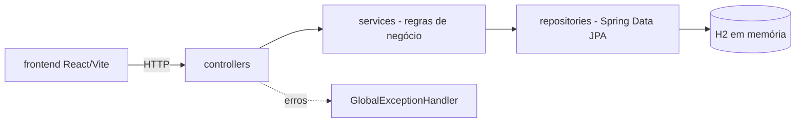

# app-bancario-digital

[English](README.en.md) · **Português (Brasil)**

[](#) [](#) [](#) [](#) [](#) [](#) [](LICENSE)

## O que é

Conta digital full-stack: **API REST em Java 21 + Spring Boot 3** para contas, depósitos, saques, transferências e extrato, com um **frontend React 18 + TypeScript** (Vite + Tailwind) que consome os endpoints. Escopo de MVP: contas, transferências com validação de saldo, extrato.

## Status

Funcional e testado: **40 testes JUnit** passando (`mvn test`), BUILD SUCCESS. Projeto acadêmico/portfólio.

## Funcionalidades

- **Contas** (`ContaController`): criar (`POST /contas`), buscar por id (`GET /contas/{id}`), listar (`GET /contas`), depositar (`POST /contas/{id}/depositar`) e sacar (`POST /contas/{id}/sacar`).
- **Transferências** (`TransferenciaController`): `POST /transferencias` valida saldo e origem/destino; falha com `SaldoInsuficienteException`.
- **Extrato** (`ExtratoController`): `GET /extrato/{contaId}` devolve os lançamentos da conta.
- **Tratamento global de erros** (`GlobalExceptionHandler`): mapeia conta inexistente, operação inválida e saldo insuficiente para respostas de erro com `ErrorResponse`.
- **Frontend**: três telas (contas, transferências, extrato por conta) em React Router.

## Arquitetura

Camadas controller → service → repository (Spring Data JPA) sobre H2 em memória; o frontend conversa com a API via HTTP.



## Stack

- Java 21, Spring Boot 3.4.4 (`starter-web`, `starter-validation`, `starter-data-jpa`)
- H2 em memória (`jdbc:h2:mem:bancodigital`, `ddl-auto=create-drop`)
- Lombok
- Frontend: React 18, TypeScript 5.6, Vite 5, Tailwind 3, react-router-dom 6
- Testes: JUnit 5 + Spring Boot Test (MockMvc, `@DataJpaTest`, testes de service)

## Estrutura do repositório

```
app-bancario-digital/
├── pom.xml · BRIEF.md
├── src/main/java/com/bancodigital/app/
│   ├── AppBancarioDigitalApplication.java
│   ├── controller/     # Conta, Transferencia, Extrato
│   ├── service/        # regras de negócio
│   ├── repository/     # interfaces Spring Data JPA
│   ├── model/          # Conta, Transferencia, Extrato
│   ├── dto/            # requests/responses
│   └── exception/      # exceções + handler global
├── src/main/resources/application.properties
├── src/test/java/...   # 40 testes (controller, repository, service)
└── frontend/           # React + TS + Tailwind + Vite
```

## Pré-requisitos e instalação

- JDK 21 e Maven 3.9+
- Node 18+ (opcional, só para o frontend)

```bash
cd frontend && npm install   # apenas para rodar a interface
```

## Como executar

```bash
# API (porta 8080)
mvn spring-boot:run

# criar conta e transferir
curl -X POST localhost:8080/contas -H 'Content-Type: application/json' \
  -d '{"titular":"Ana","saldoInicial":1000.00}'
curl -X POST localhost:8080/transferencias -H 'Content-Type: application/json' \
  -d '{"contaOrigemId":1,"contaDestinoId":2,"valor":150.00}'

# frontend
cd frontend && npm install && npm run dev
```

Observação: o banco é em memória (`create-drop`) — os dados somem a cada reinício.

## Testes e qualidade

Comando real (verificado pelo agente):

```bash
mvn test
# Tests run: 40, Failures: 0, Errors: 0, Skipped: 0
# BUILD SUCCESS
```

## Decisões técnicas e trade-offs

- **H2 em memória**: sobe e derruba sem infraestrutura; em troca, não persiste nada entre execuções.
- **Camadas controller/service/repository**: separa HTTP de regra de negócio, facilitando os testes por camada; em troca, mais arquivos para um domínio pequeno.
- **Exceções de domínio + handler global**: respostas de erro consistentes em um só lugar.
- **Frontend separado em `frontend/`**: build independente do Maven; em troca, dois comandos para subir o projeto inteiro.

## Limitações conhecidas e roadmap

- Sem autenticação/autorização e sem persistência real (banco em memória).
- Sem transferência agendada, limites ou tarifas.
- Frontend cobre o fluxo básico (não há testes automatizados nele).

## Processo de desenvolvimento

Projeto individual de Kelvin Oliveira, construído com agentes de IA orquestrados e revisado pelo autor. As decisões de modelagem e a revisão são do autor.

## Licença e autor

**Autor**: [Kelvin Oliveira](https://github.com/KelvinOliveiraCode) · [Portfólio](https://kelvinoliveiracode.github.io/portfolio/)
